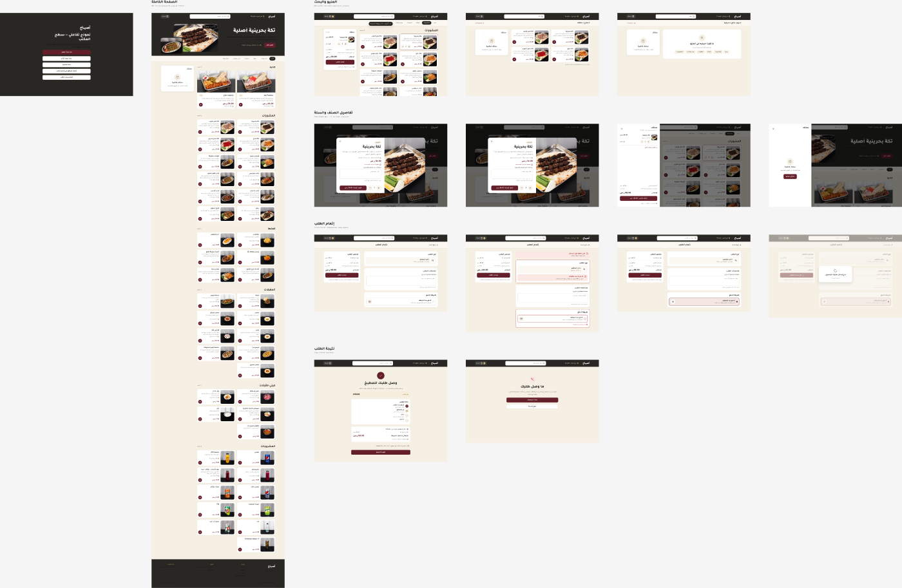
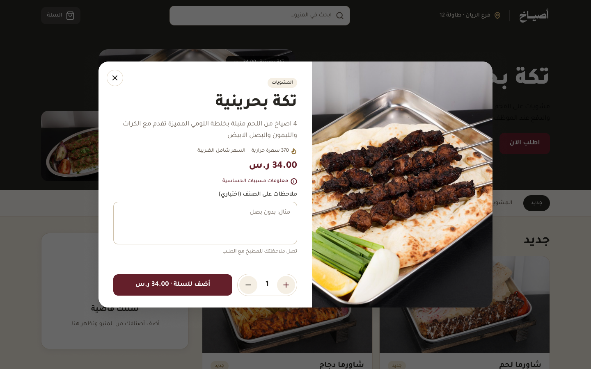
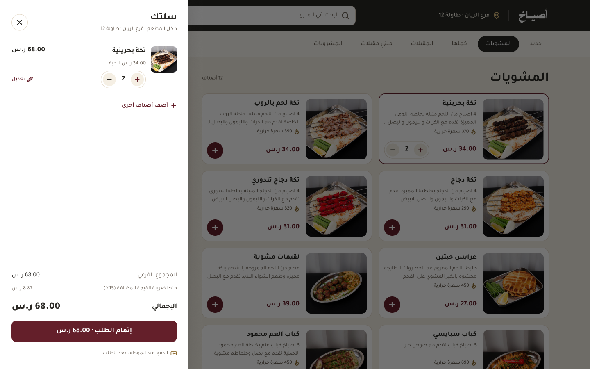
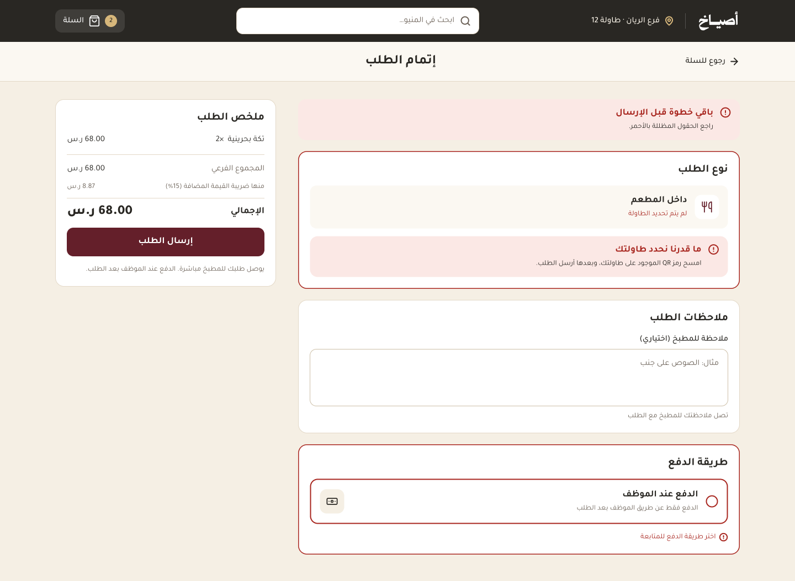
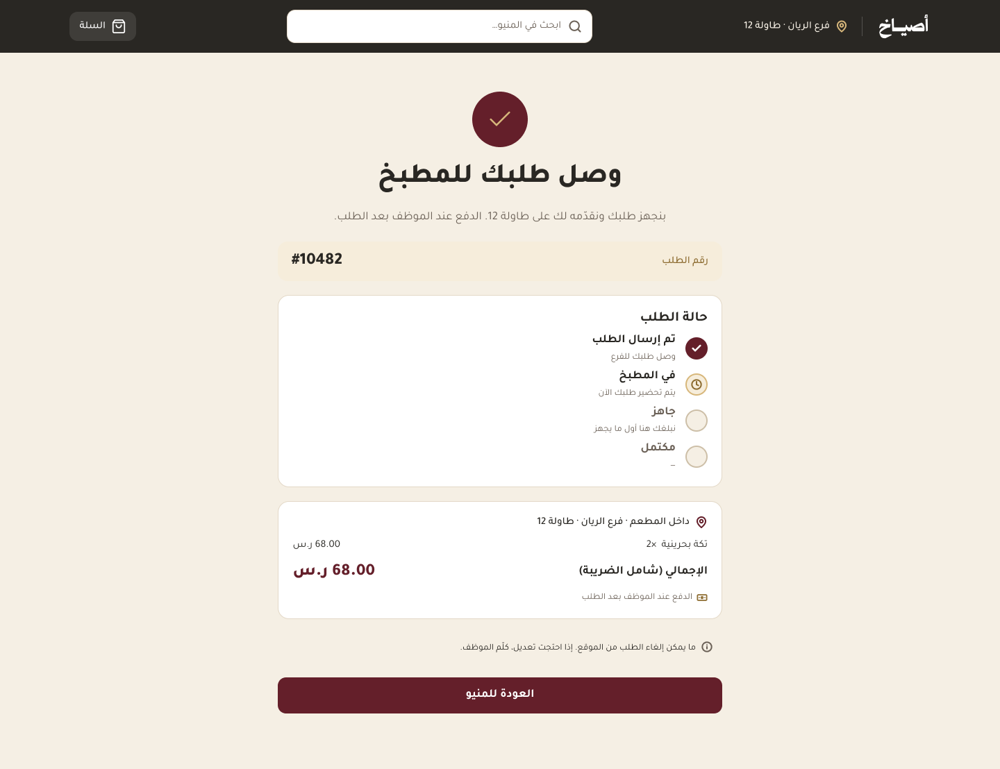
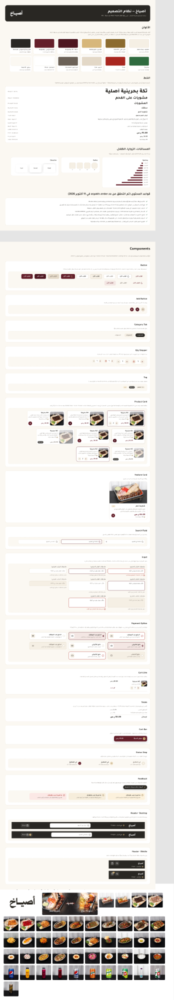
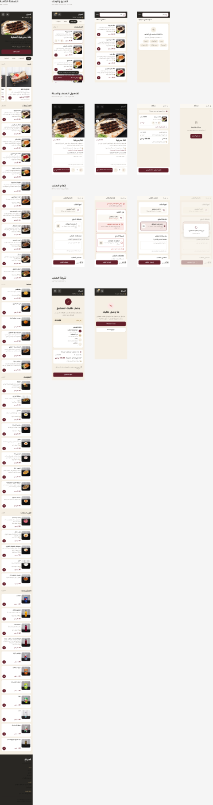

# Asyakh: Restaurant Ordering Experience Redesign (UI/UX)

A redesign of the **in-restaurant ordering experience** for *Asyakh* (أصياخ), a grill restaurant. Guests scan a QR code at their table, browse the menu, and send the order straight to the kitchen. The design is **Arabic-first (RTL)** and covers **desktop and mobile**. It includes a full **design system** and the **edge cases**, not just the happy path.

🔗 **[Open the Figma file](https://www.figma.com/design/tUiQzLOLFz71M6zX8i8pw1/Asyakh-%E2%80%94-Ordering-Experience-Redesign)**

---

## 🎯 Problem → Approach

| Problem | Design response |
|---|---|
| Long menu that is hard to scan | Sticky category tabs, a "New" section, and product cards that show price and calories |
| Unclear cart and totals | Slide-in cart drawer with quantity steppers and a VAT breakdown (15%) |
| Orders sent to the wrong table or without payment info | Checkout validates order type, table (QR) and payment method, with clear inline errors |
| No feedback after ordering | Confirmation page with an order number and a live status tracker (Sent → In kitchen → Ready → Done) |

## 🗺️ Flow & States (14 desktop screens + matching mobile)

1. **Menu & search**: landing menu, item added, search results, **no results**
2. **Item details & cart**: product modal (qty 1 → 2), cart drawer, **empty cart**
3. **Checkout**: default, **validation errors**, ready to send, **sending (loading)**
4. **Result**: order confirmed, **order failed to send**

<table>
<tr>
<td width="50%"></td>
<td width="50%"></td>
</tr>
<tr>
<td width="50%"></td>
<td width="50%"></td>
</tr>
</table>

## 🧩 Design System

Colors, Arabic type scale, spacing, radii and shadows, plus reusable components: buttons, add button, category tabs, quantity stepper, tags, product and feature cards, search field, inputs (including error states), payment options, cart line, totals, status steps, feedback banners, and desktop/mobile headers.

## 📱 Mobile

## 🛠️ Tools

Figma (components and variants, auto layout, interactive prototype)

## 👩‍🎨 Designer

**Mira Alharbi**

> Independent concept redesign made for my portfolio. I am not affiliated with the restaurant.
